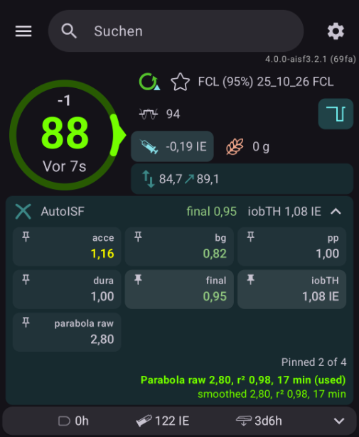

# AAPS 4.0.0 + AutoISF 3.2.1 (test version)

---

## ⚠️ READ THIS FIRST – SAFETY NOTICE

**This software can control an insulin pump. Wrong insulin doses can cause severe hypoglycemia,
diabetic ketoacidosis, loss of consciousness or death.**

- **This is an experimental test version.** It is NOT an official AndroidAPS release and is NOT
  supported, reviewed or approved by the AndroidAPS team or the AutoISF authors.
- **This is not a medical device.** It is not approved by any health authority (FDA, CE, MDR or
  any other). It is not medical advice.
- **You use it entirely at your own risk.** You alone are responsible for building it, installing
  it, choosing every setting and every insulin dose that results from it.
- **No warranty of any kind.** The software is provided "as is". The authors and contributors
  accept no liability for any harm, injury, damage or loss, direct or indirect, that results from
  using, building or sharing it (see the license, sections 15 and 16).
- **Test first, without risk:** use the virtual pump or **Open Loop** for several days. Only move
  to Closed Loop when every result has made sense to you – and then start with careful limits
  (max IOB, max SMB, AutoISF min/max).
- **Changes marked ⚠️** in the changelog can change how much insulin is given. Read them before
  you update.
- **Always keep a backup plan:** a blood glucose meter, fast carbs, insulin pen and a way to stop
  the loop at any time.
- **Do not use it** if you do not understand how AndroidAPS, OpenAPS/SMB and AutoISF work, or if
  you cannot check and correct what the loop is doing.
- **Talk to your diabetes team** before you change your therapy.

**If you do not accept these terms, do not build, install or use this software.**

---

## What this is

This fork brings **AutoISF 3.2.1** to **AndroidAPS 4.0.0** and adds features for CGM sensors
that send a value every minute (for example Libre 3 through Juggluco).

- Based on AndroidAPS 4.0.0 and JetFoxy's branch `autoisf-3.2.1` – many thanks to JetFoxy!
- Goal: AutoISF stays **as close to the original as possible**.
- No version expiry: this is not an official AAPS version, so the official version check is off.
  It would otherwise set max IOB to 0 some time after a new official release.
- The version name shows the branch: `4.0.0-aisf3.2.1` (normal), `…-dev`, `…-sport`.
- All changes in detail: [CHANGELOG-autoISF.md](CHANGELOG-autoISF.md) (German)

## Branches – which one is for me?

| Branch | What it is | For whom |
|---|---|---|
| ⭐ [`aaps4-autoisf`](https://github.com/blaqone/AAPS-autoISF/tree/aaps4-autoisf) | **Normal version – recommended.** AutoISF 3.2.1 on AAPS 4.0.0, as close to the original as possible. Only features that were tested. | **Everyone who wants to use AutoISF. Start here.** |
| [`aaps4-autoisf-dev`](https://github.com/blaqone/AAPS-autoISF/tree/aaps4-autoisf-dev) | **Test version.** The normal version plus features that are still being tested. Changes often. | Only for testers. |
| [`aaps4-autoisf-sport`](https://github.com/blaqone/AAPS-autoISF/tree/aaps4-autoisf-sport) | **Sport version – my personal mode.** The normal version plus my changes for sport: steps from a Garmin watch for the activity monitor, SMB threshold, ketoacidosis protection. More will follow. | Mainly for me. Use it only if you know what these changes do. |

How new things get in:

1. A new feature or fix is made on its own branch (`feature/...` or `fix/...`), starting from the
   normal version.
2. It is tested in `aaps4-autoisf-dev`.
3. Only when it works well, it goes into `aaps4-autoisf` (and `aaps4-autoisf-sport`).

Changes for sport are made only in `aaps4-autoisf-sport`. They do not go into the normal or the dev version.

The dev version is never merged into the normal version as a whole, so the normal version only
gets features that were tested.

## Guide

**New to AutoISF on AAPS 4.0.0?** Read the guide: [docs/AutoISF-v4-Guide.md](docs/AutoISF-v4-Guide.md) –
what is different from AutoISF on AAPS 3.x, where the settings are and how to use the new parts.

For AutoISF itself see the original documents: the AutoISF Quick Guide and BerNie's guide for Full Closed
Loop in [ga-zelle/autoISF](https://github.com/ga-zelle/autoISF), and the official AutoISF branch
[T-o-b-i-a-s/AndroidAPS 3.4.2.6+aisf3.2.1](https://github.com/T-o-b-i-a-s/AndroidAPS/tree/3.4.2.6+aisf3.2.1).

*Screenshot from the app, AutoISF chip opened. The two parabola lines at the bottom of the chip (raw and
smoothed) are only in the dev version.*

## Features

### AutoISF 3.2.1
- acce_ISF, bg_ISF, pp_ISF, dura_ISF, iobTH – as in the original
- can be enabled without engineering mode
- activity detection (activity monitor / classifier) with safety limits: activity never gives more
  insulin than autosens, inactivity never overrules an autosens that says "more sensitive"
- AutoISF values are stored in the loop result, no own database table

### One-minute values and loop interval
- the loop uses the **newest reading**, not the 5-minute grid
- UKF filter with the real one-minute readings
- **loop interval 1–10 minutes** (default 5) – at 1 the loop runs on every new value
- the **SMB interval** stays a separate setting
- BG display, trend arrow, widgets and bolus wizard use the newest value

### Parabola (acce_ISF)
- default as in the original: parabola fit on raw values
- switch: parabola on **UKF-smoothed values** (calmer, but later)
- slider: **shortest parabola** 5–20 minutes (default 10)
- when the switch is on, the APS tab shows which values the parabola uses
- *dev version only:* raw and smoothed fit side by side on the main screen, in the APS tab and as
  a graph

### CGM correction
- **Only slope and offset – no calibration, no extra smoothing**
- `BG = value × slope + offset` for every value that comes in through xDrip (also Juggluco)
- example: the sensor always reads 30 mg/dL too low → offset +30
- set in the xDrip source settings or in the AutoISF settings; it always applies and is also
  stored and uploaded (Nightscout)

### Scenes and automations
- scenes can change **AutoISF on/off, acce weight and iobTH** while they run –
  the old values come back automatically at the end
- automation actions: enable/disable AutoISF, set acce weight, set iobTH
- automation triggers: acce weight, iobTH (compatible with rules from AutoISF 3.2.1)

### Display
- BG age in seconds
- AutoISF chip on the main screen, under the BG: closed one line with the values you pinned, a tap
  opens all values (pin up to 4), a long press opens the AutoISF screen with the calculation
- pink BG parabola on the BG graph, as in AutoISF 3.2.1: solid over the fitted minutes, dashed
  20 minutes ahead
- holding a point of the BG graph shows the smoothed value and the raw value in brackets
- coloured BG dots every minute with a 1 minute CGM and UKF smoothing (display only)
- graphs for the AutoISF factors and iobTH (also in the IOB graph)

Everything that only concerns AutoISF (graph lines, scene section, automations, main screen
lines) is hidden when AutoISF is not the active APS plugin.

## Building

1. Install Android Studio, clone this repository, check out the branch you want –
   **normally `aaps4-autoisf`**
   (see [Branches](#branches--which-one-is-for-me))
2. Build `fullDebug` (for testing) or a signed `fullRelease` with your own keystore
3. Copy the APK to the phone and install it

No ready-made APK is provided.

## Before your first test

- export the settings of your current app
- best use a second phone or the virtual pump
- start in **Open Loop**; move to Closed Loop only after several days that made sense
- choose careful limits (max IOB, max SMB, AutoISF min/max)

## Feedback

Bugs and ideas are welcome as an [issue](https://github.com/blaqone/AAPS-autoISF/issues) –
ideally with a screenshot of the APS tab and the time.

## License

Same as AndroidAPS: GNU Affero General Public License v3.0 (AGPL-3.0).
This program comes with ABSOLUTELY NO WARRANTY, to the extent permitted by applicable law.

---

<!-- changelog:start -->
## Changelog (German)

The newest changes. ⚠ = this change can affect insulin dosing.

### 2026-11-13 (35) – Deutsche Texte, AutoISF-Chip, COB, SMB-Dreieck, Einstellungs-Fenster (nur dev, im Test)

- **Deutsche Übersetzung** für alle Texte, die AutoISF4 selbst eingebaut hat (Einstellungen, AutoISF-Chip,
  Automation, Szenen, Sport-Modus …). Diese Texte gibt es bei Crowdin nicht – deshalb waren sie bisher englisch.
  Andere Sprachen zeigen sie weiter auf Englisch.
- **AutoISF-Chip:** oben kein „AutoISF“-Text mehr – der letzte angeheftete Wert wurde dadurch abgeschnitten.
  Die Werte verteilen sich jetzt über die ganze Breite. Unten im aufgeklappten Chip: „AutoISF 3.2.1 · 3 von 4 angeheftet“.
- **ISF-Zeile:** rechts steht „AutoISF“, solange AutoISF der aktive Algorithmus ist.
- **COB:** Bei 0 g (und keine KH nötig) verschwindet der COB-Chip, IOB hat dann die ganze Zeile.
- **SMB-Dreieck im Loop-Symbol:** voll = SMB an und im letzten Loop-Lauf erlaubt; **gelb = SMB an, aber gerade
  gesperrt** (ungerades Ziel, Max-IOB 0, IOB über iobTH, Unterzucker vorhergesagt, zu großer Delta); kein Dreieck =
  SMB aus. Vorher zeigte das Dreieck nur die Einstellung. Nur Anzeige.
- **Einstellungs-Fenster scrollen** (KH, Insulin, Füllen, Bolus-Rechner, Katheter-Wechsel …): Bei großer Schrift
  oder Querformat waren die untersten Einstellungen nicht erreichbar (AAPS-Issue #5564).

### 2026-11-12 (34) – Activity Classifier entfernt

- ⚠ **Der Activity Classifier ist ganz entfernt** – Code, die Einstellungen „Use ActivityClassifier“,
  „activity target offset“, „ActivityClassifier sensitivity“ und „Resting heart rate“ sowie die
  Aktivitätserkennung des Handys (Gehen/Laufen/Rad), die nur er genutzt hat. Er gehörte nicht zu AutoISF 3.4
  (kam mit der AAPS-4-Basis) und hat Ziel und SMB-Größe verändert.
- Der **Activity Monitor** (Schritte, Original AutoISF) bleibt unverändert, ebenso der Schrittzähler des Handys
  und die Uhr-Schritte.
- Der letzte Stand des Classifiers liegt weiter auf GitHub im Zweig `fix/activity-classifier-steps`,
  wird aber in keine Version eingebaut.

### 2026-11-12 (32) – Gemeldete Fehler: AutoISF-Tab, BZ-Anzeige, iobTH-Legende, Classifier aus (nur dev, im Test)

- **AutoISF-Tab** wie in AutoISF 3.4.2.6: zuerst das Ergebnis (Script Debug, Result, Request – offen), dann die
  Eingaben (zugeklappt, außer Glucose Status). Der **Glucose Status zeigt jetzt alle AutoISF-Werte** (duraISF,
  Parabel a0–a2, corrSqu, deltaPl/deltaPn, bgAcceleration …), das **Profil die Schritte** (recent_steps 5–60,
  phone_moved, activity_detection …).
- **Log:** statt `rawFit=…; smoothedFit=…` steht nur noch `FitUsesRaw=…` (Gerhards Analyse-Werkzeug stürzte am Namen ab).
- **Einheitlicher BZ-Wert:** Benachrichtigung/Statusleiste, Wear-Uhr, SMS und Tizen zeigen jetzt denselben, neuesten
  Wert wie Hauptbildschirm und Loop. Vorher nahmen sie bei einem 1-Minuten-Sensor einen bis zu 4 Minuten alten
  Wert (z. B. 81 in der Statusleiste, 74 im Hauptbildschirm). Nur Anzeige.
- **IOB-Graph:** In der Legende ist iobTH jetzt gestrichelt wie seine Linie und hellviolett statt hellblau –
  vorher kaum von IOB zu unterscheiden (gemeldet von Gerhard).
- ⚠ **Activity Classifier ist jetzt standardmäßig aus.** Er gehört nicht zu AutoISF 3.4 (kam mit der AAPS-4-Basis)
  und ändert Ziel und SMB-Größe – das soll niemand ungefragt haben. Wer ihn will, schaltet ihn in den
  Activity-Monitor-Einstellungen ein; wer ihn schon selbst eingeschaltet hatte, behält ihn.

### 2026-11-11 (29) – Update direkt von AutoISF 3.4.2.6 möglich (nur dev, im Test)

Bisher ist die App beim Update über **AAPS 3.4.2.6 + AutoISF 3.2.1** bei jedem Start abgestürzt.

- **Grund 1 – Datenbank-Version 32 doppelt belegt:** AutoISF 3.4 nutzt Version 32 für seine Tabelle
  `autoIsfValues`, AAPS 4 für die Spalte `carbInsulin` in den Tagesdosen (TDD). Die App sah „32“ und hat
  einen Schritt übersprungen – danach fehlte die Spalte.
  **Fix:** Am Anfang des Schritts 32→33 wird geprüft, ob `carbInsulin` fehlt. Wenn ja: TDD-Cache leeren
  (wird neu berechnet) und die Spalte anlegen. Die alte Tabelle `autoIsfValues` wird gelöscht (die
  AutoISF-Werte stehen jetzt in den APS-Ergebnissen). Bei einer normalen AAPS-4-Datenbank passiert nichts.
- **Grund 2 – unbekannte Einträge im Benutzerprotokoll:** AutoISF 3.x schrieb `AUTOISF_ENABLED`,
  `AUTOISF_DISABLED`, `IOB_TH_SET` und `ACCE_WEIGHT_SET`. Diese Version kennt sie nicht und wäre beim Lesen
  (Protokoll, Nightscout-Upload) abgestürzt.
  **Fix:** Diese Einträge werden zu „UNKNOWN“, und jeder unbekannte Eintrag wird künftig als „UNKNOWN“
  gelesen statt abzustürzen.
- Die übrige Historie (BZ, Boluse, Profile, TT …) bleibt erhalten.
- Vor dem Update trotzdem **Einstellungen exportieren**. Gleicher Signaturschlüssel nötig, sonst muss die
  alte App deinstalliert werden. Zurück auf 3.4 geht nicht ohne Verlust der Datenbank.
- Bitte zuerst auf einem **Zweithandy** testen: 3.4.2.6 + AutoISF installieren, ein paar Stunden laufen
  lassen, dann diese Version darüber installieren.

### 2026-11-11 (28) – Activity Monitor: Schritte von der Uhr (Wear OS, Garmin) (nur dev, im Test)

Bisher hat der AutoISF Activity Monitor nur den Schrittsensor im Handy genutzt. Wer das Handy liegen
ließ und nur die Uhr trug, bekam keine Aktivität erkannt. Jetzt kann er auch die Schritte einer Uhr nutzen.

- ⚠ **Neue Einstellung „Steps from“** (Activity Monitor): **Phone** / **Watch (Garmin, Wear OS)** /
  **Automatic** (Standard).
  - *Phone*: wie bisher, nur der Schrittsensor im Handy.
  - *Watch*: nur die Uhr. Hat die Uhr in den letzten 10 Minuten nichts geschickt, ändert der Monitor nichts
    (Faktor 1,0).
  - *Automatic*: die Uhr, wenn sie in den letzten 10 Minuten Schritte geschickt hat, sonst das Handy.
    Ohne Uhr ist also alles wie bisher.
- **Woher die Uhr-Schritte kommen:** alles, was eine Uhr als Schritte speichert:
  - **Wear OS**: die AAPS-Wear-App schickt die Schritte (mit Milos' Fix #5499 als Summen).
  - **Garmin**: das Watchface kann die Schritte bei seinen Abfragen mitschicken (als Zeitfenster
    5/10/15/30/60 min oder als Tagessumme). Nach einer Lücke über 15 Minuten oder nach Mitternacht wird
    neu angefangen, damit alte Schritte nie wie „gerade aktiv“ aussehen. Das Watchface muss das
    unterstützen.
- **Nichts wird doppelt gezählt:** Es zählt immer nur die **neueste** Uhr-Zeile. Die Wear-Uhr schreibt
  6 Zeilen gleichzeitig (eine pro Zeitfenster), davon wird nur die längste mit allen Werten genommen.
  Die Handy-Zeilen (jede Minute) werden nie als Uhr-Schritte genommen.
- **Die Monitor-Logik bleibt wie im Original AutoISF:** gleiche Grenzen (300/200 je 5-Minuten-Block,
  1500/500 für 30 min, 2500/800 für 60 min), gleiche Faktoren, gleiche Nacht-Regeln. Die Summen der Uhr
  werden dafür in 5-Minuten-Blöcke umgerechnet (10 min − 5 min usw.).
- Mit Uhr-Schritten entfallen die Prüfung „Handy wird nicht getragen“ und die Wartezeit nach dem
  App-Start – die gelten nur für den Handy-Sensor.
- ⚠ Der Activity Classifier bekommt die Summe der letzten 15 Minuten aus derselben Quelle.
- Im Log steht bei jeder Erkennung, ob die Schritte von „phone“ oder „watch“ kamen.
- Gleiche Funktion wie in der sport-Version, aber **ohne** die Einstellung „Nacht ist“.

All changes: [CHANGELOG-autoISF.md](CHANGELOG-autoISF.md)
<!-- changelog:end -->
