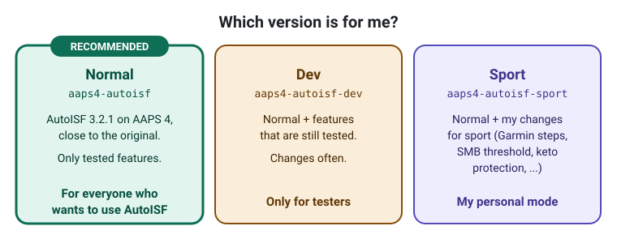
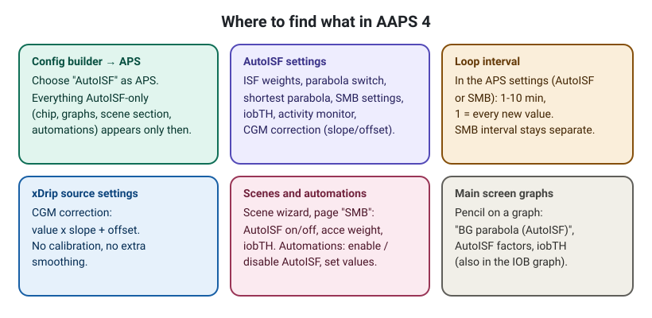
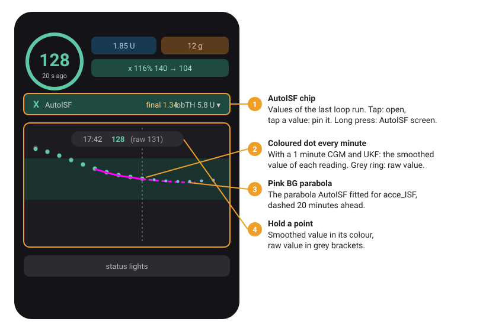

# AutoISF 3.2.1 on AAPS 4 – guide

This guide is for people who know AutoISF from AAPS 3.x and want to use it on AAPS 4. It explains
**what is different in AAPS 4**, **where the settings are now** and **how to use the new parts**.

It does not explain AutoISF itself again. For that, read the original documents first:

- **AutoISF Quick Guide** (English) and **Kurzanleitung** (German draft):
  [ga-zelle/autoISF](https://github.com/ga-zelle/autoISF) – `autoISF3.2.0_Quick_Guide.pdf`,
  `autoISF3.2.0_Kurzanleitung_ENTWURF.pdf`
- **BerNie's guide for Full Closed Loop**:
  [BerNie's guide for Full Closed Loop.md](https://github.com/ga-zelle/autoISF/blob/A3.4.2.6_ai3.2.1/BerNie's%20guide%20for%20Full%20Closed%20Loop.md)
- **Official AutoISF branch** (AAPS 3.4.2.6 + AutoISF 3.2.1):
  [T-o-b-i-a-s/AndroidAPS, branch 3.4.2.6+aisf3.2.1](https://github.com/T-o-b-i-a-s/AndroidAPS/tree/3.4.2.6+aisf3.2.1)

> ⚠️ This is a test version, not an official AAPS or AutoISF release. Read the safety notice in the
> [README](../README.md) first. Start with the virtual pump or Open Loop.

---

## 1. Which version?

| You want to … | Use |
|---|---|
| use AutoISF on AAPS 4 | **`aaps4-autoisf` (normal)** – recommended |
| test new things early and give feedback | `aaps4-autoisf-dev` |
| use the sport changes (Garmin steps, SMB threshold, keto protection) | `aaps4-autoisf-sport` |

The version name in the app shows which one you have: `4.0.0-aisf3.2.1` (normal), `…-dev`, `…-sport`.

---

## 2. Coming from AAPS 3.x with AutoISF

1. **Export your settings** in your old AAPS (Maintenance → Export settings).
2. Install AAPS 4 + AutoISF. Best on a second phone or with the virtual pump first.
3. **Import the settings.** AutoISF settings, automations with the AutoISF actions and triggers, and the
   **states** (for example "Sleeping") are read. In AAPS 4 an import is applied without restarting the app;
   imported states count at once.
4. In the **Config builder → APS** choose **AutoISF**.
5. Check the settings described below, especially the new ones. Then start in **Open Loop**.

---

## 3. Where to find what

- **AutoISF settings** – open them from the AutoISF plugin (Config builder → APS → AutoISF → gear). The
  screen has the same parts as in 3.2.1: ISF weights (acce, bg, pp, dura), iobTH, SMB settings, activity
  monitor. New in AAPS 4: the parabola switch and slider, and the CGM correction (see below).
- **Loop interval** – in the APS settings (AutoISF or SMB): 1–10 minutes, default 5.
- **CGM correction** – in the xDrip source settings and in the AutoISF settings.
- **Graphs** – the pencil on each graph of the main screen.
- **Scenes** – main screen → Scenes. **Automations** – main menu → Automation.

Everything that only belongs to AutoISF (chip, AutoISF graphs, scene section, automations, iobTH in the IOB
graph) is **only shown when AutoISF is the active APS**.

---

## 4. What is new or different in AAPS 4

### 4.1 One-minute values and the loop

- The loop uses the **newest reading**, not the 5-minute grid. With a 1-minute CGM (for example Libre 3
  through Juggluco) the BG, delta and the AutoISF parabola are up to date every minute.
- **Loop interval** 1–10 minutes. At 1 the loop runs on every new value. The **SMB interval** stays its own
  setting.
- **IOB** is calculated fresh for the moment of each loop run. **COB and autosens** stay on the 5-minute grid
  on purpose: their formulas (deviations, min_5m_carbimpact) are made for 5 minutes.
- **UKF smoothing** works with the real 1-minute readings.

### 4.2 Parabola (acce_ISF)

- **Default as in the original:** the parabola is fitted to the raw values.
- **Switch "Parabola on smoothed values":** the parabola uses the UKF-smoothed values instead. Calmer, but
  later. Needs UKF and a 1-minute CGM, otherwise the raw values are used.
- **Slider "Shortest parabola":** 5–20 minutes, 10 as in the original.
- The APS tab says which values the parabola used.

### 4.3 CGM correction (only slope and offset)

`BG = value × slope + offset` for every value that comes in through xDrip (also Juggluco).
Slope 0.5–1.5, offset −50 … +50 mg/dl, never below 40 mg/dl. Default 1.00 / 0 = no change.
**No calibration and no extra smoothing.** Example: the sensor always reads 30 mg/dl too low → offset +30.
It applies with every APS and is also uploaded to Nightscout.

### 4.4 Activity monitor

Same rules and steps as in 3.2.1, with two safety limits:

- Activity never gives more insulin than autosens alone would.
- Inactivity never overrules an autosens that says "more sensitive", and never goes above autosens max.

The activity monitor and the activity classifier are **off during every temp target**, so with exercise mode
(a high temp target) sensitivity is never lowered twice.

### 4.5 Scenes and automations

- **Scene wizard, page "SMB" → section "AutoISF":** a scene can switch AutoISF on or off, set the acce weight
  (0–1) and iobTH (10–100 %) for its time. At the end (by hand or when the time is over) the old values come
  back, also after an app restart.
- **Automations** as in 3.2.1: actions *Enable / Disable AutoISF*, *Set acce weight*, *Set iobTH*; triggers
  *acce weight* and *iobTH*. Rules from AAPS 3.x can be read.
- **States** (for example "Sleeping") are in the settings export. They are read fresh, so an import counts at
  once and the states screen updates live.

### 4.6 Main screen

1. **AutoISF chip** under the BG: the values of the last loop run.
   - Closed: one line with the values you pinned (default *final* and *iobTH*).
   - **Tap** opens it: acce, bg, pp, dura, final, iobTH in a grid. **Tap a value** to pin it to the closed
     line or remove it (at most 4).
   - **Long press** opens the AutoISF screen with the calculation.
   - A factor above 1 (stronger, more insulin) is orange, below 1 green.
2. **Coloured dot every minute:** with a 1-minute CGM and UKF there is a coloured dot (smoothed value) for
   every reading. The grey ring is the raw value. Display only.
3. **Pink BG parabola** as in AutoISF 3.2.1: the parabola AutoISF fitted, solid over the fitted minutes and
   dashed 20 minutes ahead (with predictions on). Switch it with the pencil on the BG graph →
   *BG parabola (AutoISF)*.
4. **Hold a point** of the BG graph: the smoothed value in its colour, the raw value in grey brackets, for
   example `128 (raw 131)`.

The BG age is shown in seconds.

### 4.7 Graphs

With the pencil you can add the AutoISF factors (acce, bg, pp, dura, final) and iobTH to a graph below BG.
iobTH can also be shown in the fixed IOB graph.

### 4.8 No version expiry

This is not an official AAPS version. The official version check is off, because it would set max IOB to 0
some time after a new official release and so end closed looping. Closed loop works without engineering
mode; the AAPS objectives still apply.

---

## 5. Using it day to day

- **SMB on even, off on odd targets** works as in 3.2.1 ("Enable SMB on even target"): a temp target of 141
  switches SMB off, 140 keeps it on.
- **iobTH** limits how much IOB SMBs may build up. Lower it in a scene for times when you want to be careful.
- **Exercise mode** = "High temp target raises sensitivity": with a temp target above the normal target the
  loop gives less insulin. Without a high temp target the switch alone does nothing. A scene is the easiest
  way: high temp target + optional AutoISF values, everything comes back at the end.
- **Check the APS tab** after changes: it shows the factors, the parabola and the reasons of the last run.

---

## 6. Help

Bugs and ideas: [issues](https://github.com/blaqone/AAPS-autoISF/issues), ideally with a screenshot of the
APS tab and the time. All changes: [CHANGELOG-autoISF.md](../CHANGELOG-autoISF.md) (German).
